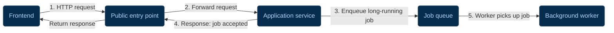

# Approved note style

The API Gateway note is the user's reference for concise, Botfood-specific interview notes. Inspect the current note when accessible and preserve user edits. These examples define presentation, not permanent facts about Botfood architecture.

## Shape and depth

- Start with one or two sentences explaining whether/how Botfood uses the concept.
- Link the guide or identify the attachment/text/screenshots.
- Follow the source's headings and subsection order. Expand difficult distinctions only when useful.
- Prefer a concrete example, a short tradeoff, and a short interview sentence where helpful.
- Use numbered steps for processes and small tables for comparisons or technology roles.
- Explain acronyms once; distinguish general concepts from specific AWS products.
- Use product language: opening the Library, reading Wiki content, adding files, connecting an app, tracking a job, or viewing billing.
- Describe verified implementation as system behavior. Personal contributions require evidence or the user's statement.

Useful section ingredients, not a mandatory repeated form:

```markdown
### <Source subsection heading>

<One-sentence meaning tied to Botfood.>

**Botfood example:** <Verified workflow or clearly labeled design option.>

1. <First action.>
2. <Next action.>
3. <Result.>

**Tradeoff:** <Benefit and cost in one or two sentences.>

**Interview:** “<Short statement the user can explain aloud.>”
```

Aim for the brevity of the current API Gateway note rather than a fixed word count that ignores topic complexity. Cover substantive guide sections while avoiding repeating the same explanation in prose, tables, steps, and diagrams.

## Mermaid diagrams

Use a small number of useful diagrams. Rounded blue nodes match the approved overview. Put frontend/client on the left by default, with routing, processing, and storage progressing rightward. Use top-down when requested or materially clearer.

Label arrows with what travels: HTTP request, JSON response, MCP tool request, queued job, database query, or result. Number stages consistently with accompanying steps. Separate job acceptance from completion. Include reverse arrows when useful; otherwise give a short response-path sentence.

Use actual service names when relevant. An ECS-managed task running on Fargate is a running workload, not one queued job. Show multiple task copies when explaining distribution/scaling and identify illustrative counts.

Adaptable style example (placeholder services, not Botfood claims):



Use quoted labels and `<br/>` for controlled line breaks. Keep labels readable at normal note width. Saved Mermaid fences stand alone: no outer four-backtick wrapper or generic code block.
